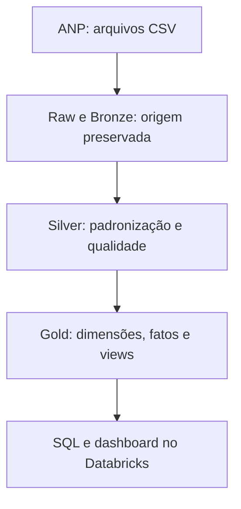
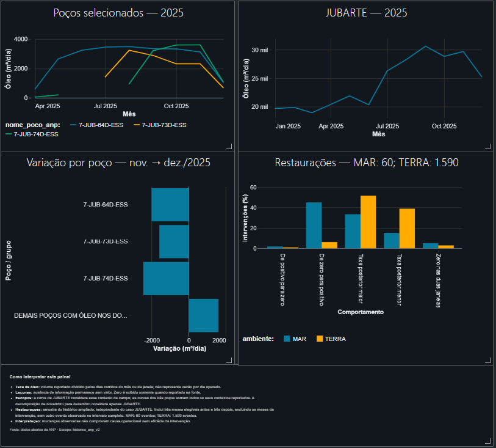

# Oil & Gas Production Lakehouse — ANP

**Lakehouse analítico no Databricks para investigar a produção de petróleo, a contribuição dos poços e o comportamento observado antes e depois de intervenções.**

Projeto de engenharia de dados com dados públicos da ANP: ingestão de arquivos com diferentes layouts, camadas Bronze/Silver/Gold em Delta Lake, data warehouse dimensional, auditoria e dashboard no próprio Databricks.

**Primeira versão analítica implementada e validada no workspace em outubro de 2026.** Este repositório reúne a documentação, os três notebooks exportados do workspace e uma imagem do dashboard. A execução atual é conduzida por notebooks, sem orquestração automática configurada.

## O problema

Uma queda de produção em um campo pode estar concentrada em poucos poços. Para investigá-la, é necessário integrar arquivos históricos e cadastrais, distinguir ausência de informação de zero reportado e relacionar intervenções à produção sem multiplicar volumes.

O projeto permite responder:

- Como a produção evolui por mês, ambiente, bacia e contexto de campo?
- Quais poços contribuem para a variação observada em um campo?
- Há registros de intervenção próximos ao período investigado?
- Como a taxa média de óleo muda entre janelas anteriores e posteriores às intervenções?
- Quais comparações são limitadas por lacunas ou por outros eventos no mesmo poço?

## Resultados da versão

| Entrega | Resultado validado |
| --- | --- |
| Produção e injeção publicadas na Gold | **315.356 registros**, com identificadores de fato distintos |
| Intervenções publicadas na Gold | **17.817 registros**, com identificadores de fato distintos |
| Snapshot cadastral publicado | **27.316 registros** de uma versão coletada em 15/10/2026 |
| Arquivos no escopo histórico | **16 conteúdos**: 13 de produção, 2 de intervenções e 1 cadastral |
| Reconciliação de produção: arquivos originais × Silver | **169 verificações arquivo/medida aprovadas** |
| Reconciliação de agregados mensais: Gold × indicadores | **26 verificações dataset/medida aprovadas** |
| Comparação de óleo antes/depois | **3.590 intervenções** com três meses elegíveis em cada janela |
| Restaurações sem outro evento observado no intervalo analisado | **1.650 eventos**: 60 em mar e 1.590 em terra |

As verificações de reconciliação conferem conservação dos dados entre etapas. Não representam uma conciliação independente com totais nacionais de outro boletim da ANP.

## Fonte e cobertura

Fonte oficial: [ANP — Fase de Desenvolvimento e Produção](https://www.gov.br/anp/pt-br/centrais-de-conteudo/dados-abertos/fase-de-desenvolvimento-e-producao).

| Conjunto | Arquivos | Registros | Cobertura observada |
| --- | ---: | ---: | --- |
| Produção em mar | 3 | 43.919 | Janeiro/2024 a agosto/2026 |
| Produção em terra | 10 | 271.437 | Janeiro/2024 a junho/2026, com lacuna em abril/2026 |
| Intervenções em poços | 2 | 17.817 | Inícios de janeiro/2023 a agosto/2026; términos até setembro/2026 |
| Situação de poços | 1 | 27.316 | Snapshot coletado em 15/10/2026, com datas de referência próprias por registro |

A cobertura corresponde aos conteúdos efetivamente coletados. Um mês com registros não garante que todos os poços ou informações esperados tenham sido publicados.

O arquivo terrestre do segundo trimestre de 2026 contém somente maio e junho. Abril permanece como lacuna; julho e agosto estão após o último mês terrestre observado. Esses períodos não recebem produção igual a zero.

## Arquitetura



A camada **Ops** registra coletas, hashes, contratos de leitura, cargas, verificações e composição dos escopos analíticos.

| Camada | Responsabilidade |
| --- | --- |
| Raw | Arquivos originais em Volume, organizados por dataset e SHA-256 do conteúdo |
| Bronze | Campos de negócio como texto e metadados de origem, arquivo e execução |
| Silver | Conversão de tipos, normalização de identificadores, datas, medidas e regras de qualidade |
| Gold | Modelo dimensional, fatos versionados e views de consumo |
| Ops | Rastreabilidade, contratos de arquivos, auditoria e reconciliações |

Schemas no catálogo `workspace`: `oil_gas_bronze`, `oil_gas_silver`, `oil_gas_gold` e `oil_gas_ops`.

Volume de arquivos originais: `/Volumes/workspace/oil_gas_bronze/raw_files`.

### Decisões de engenharia

- **Conteúdo identificado por SHA-256:** arquivos já armazenados podem ser reutilizados; novos conteúdos são preservados como novas versões.
- **Layout alinhado por nome normalizado:** o quarto trimestre terrestre de 2025 alterou a ordem das colunas. A ingestão respeita o cabeçalho de cada arquivo.
- **Datas com formatos diferentes:** tratamento de competências numéricas e abreviações em português, como `out/2025`.
- **Decimais brasileiros:** valores como `2.866,80` são validados e convertidos para `DECIMAL(28,9)`.
- **Nulo diferente de zero:** medidas ausentes e meses sem registro não são preenchidos automaticamente com zero.
- **Contexto reportado preservado:** divergências entre produção e cadastro são sinalizadas, sem substituir o contexto histórico pelo cadastro atual.
- **Cargas com verificação de conteúdo e MERGE de inserção:** evitam reinserção das mesmas versões nas etapas implementadas para execução sequencial. Concorrência entre cargas não foi validada.
- **Publicação por escopo:** `historico_anp_v2` fixa os hashes dos arquivos e as versões de transformação utilizados nas views.

## Data warehouse

| Objeto | Granularidade ou função |
| --- | --- |
| `dim_data` | Um dia; calendário de 2023 a 2026, incluindo 29/02/2024 |
| `dim_poco` | Identificador ANP, com membro específico para ausência de identificação |
| `dim_campo` | Contexto reportado de campo e bacia |
| `dim_instalacao` | Contexto de instalação, ambiente, estado e bacia; membro para contexto incompleto |
| `fato_producao_injecao_mensal_v2` | Registro mensal por ambiente, poço, campo e instalação, dentro da versão do arquivo |
| `fato_intervencoes_v2` | Registro de intervenção dentro da versão do arquivo |
| `fato_snapshot_cadastro` | Registro cadastral observado na versão coletada |

**Poço + mês não identifica uma linha de produção.** Um mesmo poço pode ter volumes reportados em vários contextos de campo no mesmo mês. O modelo preserva essa granularidade antes de agregar por poço ou campo.

As intervenções são tratadas separadamente dos volumes mensais. O cruzamento analítico controla a granularidade para evitar somar produção repetida quando há vários eventos.

Views publicadas:

- `workspace.oil_gas_gold.vw_producao_historico_v2`
- `workspace.oil_gas_gold.vw_intervencoes_historico_v2`
- `workspace.oil_gas_gold.vw_cadastro_historico_v2`

## Qualidade e rastreabilidade

Os controles incluem estrutura dos CSVs, alinhamento de cabeçalhos, contagem por arquivo, chaves, competências, conversão de medidas, duração inclusiva das intervenções, vínculos dimensionais e reconciliação entre camadas.

Exceções preservadas e documentadas:

- **1.116 registros terrestres** sem instalação informada.
- **16 registros marítimos** com instalação informada, mas estado ausente.
- **1 intervenção** sem identificador ANP.
- **112 registros cadastrais** sem identificador ANP.
- No cadastro georreferenciado: **27.173 pares válidos**, **143 pares ausentes** e nenhum par classificado como inválido pela validação implementada.

Registros sem identificador não são vinculados por aproximação de nome. O cadastro é um snapshot: seus atributos atuais não são usados como evidência da situação do poço em um mês anterior.

## Dashboard e evidência analítica



[Abrir dashboard no Databricks](https://dbc-487363e2-3add.cloud.databricks.com/editor/notebooks/3298685177734887/dashboards/63edd4fb-75a1-4732-9037-381f4a79116a?o=7474654958318993) — requer autenticação e permissão no workspace. A imagem acima permite visualizar o painel sem esse acesso.

O dashboard no workspace reúne quatro visualizações:

1. Taxa mensal de óleo de três poços selecionados, somando seus contextos reportados.
2. Evolução mensal do contexto de campo JUBARTE em 2025.
3. Contribuição dos poços para a variação de JUBARTE entre novembro e dezembro de 2025.
4. Distribuição dos comportamentos antes/depois das restaurações, separada entre mar e terra.

**Taxa de óleo** significa volume reportado dividido pelos dias corridos do mês ou da janela. Não equivale à vazão por dia efetivamente operado.

### Caso JUBARTE: novembro → dezembro de 2025

A taxa média de óleo do contexto JUBARTE passou de **29.705,812 para 25.258,582 m³/dia calendário**, uma redução de **14,97%**.

| Componente | Contribuição para a variação, em m³/dia calendário |
| --- | ---: |
| 7-JUB-74D-ESS | −2.457,603 |
| 7-JUB-64D-ESS | −2.007,613 |
| 7-JUB-73D-ESS | −1.590,155 |
| Demais 35 poços com óleo informado nos dois meses | +1.608,141 |
| **Variação líquida dos 38 poços comparáveis** | **−4.447,230** |

A decomposição reconciliou a variação do campo dentro da precisão adotada. A redução também aparece ao somar todos os contextos reportados dos três poços selecionados. Todos estavam associados à instalação reportada FPSO MARIA QUITÉRIA nesses dois meses.

Não foram observadas intervenções nesses três poços entre setembro e dezembro de 2025 no conjunto coletado. Os dados identificam a concentração da queda, mas não comprovam sua causa operacional.

### Comparação antes/depois de intervenções

A análise utiliza três meses completos anteriores ao mês de início e três posteriores ao mês de término. Os meses abrangidos pela intervenção ficam fora das janelas de produção.

Para o grupo de restaurações sem outro evento observado, a busca por eventos adicionais considera todo o intervalo entre o início da janela anterior e o fim da posterior, incluindo os trechos excluídos das janelas mensais.

Percentuais são calculados separadamente por ambiente, sobre **60 eventos marítimos** e **1.590 terrestres**. Um mesmo poço pode aparecer em mais de um evento; essas quantidades não representam poços únicos.

**Associação temporal não comprova eficácia da intervenção.**

## Stack e organização dos notebooks

**Databricks Free Edition · Python · PySpark · SQL · Delta Lake · Unity Catalog · Volumes · visualizações nativas**

A implementação foi realizada pelo navegador, com coleta direta dos arquivos para o ambiente Databricks, sem instalação local para o processamento. O uso do ambiente está sujeito às cotas da modalidade gratuita.

| Notebook desenvolvido no workspace | Conteúdo |
| --- | --- |
| [01_environment_and_source_discovery](notebooks/01_environment_and_source_discovery.ipynb) | Ambiente, descoberta, piloto completo e inventário para expansão |
| [02_incremental_ingestion](notebooks/02_incremental_ingestion.ipynb) | Coleta ampliada, contratos, Bronze/Silver/Gold e análises históricas |
| [03_analise_visual](notebooks/03_analise_visual.ipynb) | Consultas dos gráficos e nota de interpretação |

Os notebooks em `notebooks/` são os exports enviados do workspace, com código, saídas e metadados preservados. Os nomes foram padronizados sem o sufixo de download `(1)`. Sua publicação não implica validação de execução integral em um ambiente novo.

### Execução e reprodução

A ordem lógica é preparação e piloto → expansão histórica → visualizações. As etapas pressupõem acesso às URLs da ANP, permissão para criar schemas, tabelas e Volume e disponibilidade dos conteúdos usados.

A versão atual conserva células exploratórias e referências à execução original. Algumas etapas selecionam o contrato mais recente. Uma configuração explícita de contrato foi validada contra os 15 arquivos históricos de produção/intervenções, mas sua adoção em todas as etapas permanece pendente.

Portanto, ainda não há um procedimento validado de execução integral em um workspace vazio. O dashboard também depende das tabelas, views, resultados e configurações do workspace original; não constitui um painel público hospedado no GitHub.

## Limitações e próximas evoluções

- [x] Publicar os três notebooks e a imagem final do dashboard no repositório.
- Centralizar parâmetros de coleta, contrato e escopo; remover dependências de execução e células de recuperação do fluxo principal.
- Validar a execução completa em ambiente limpo e a reexecução das mesmas entradas.
- Configurar orquestração e acompanhamento de execuções.
- Ampliar coletas cadastrais para observar alterações ao longo do tempo. Uma única coleta não constitui histórico SCD Tipo 2.
- Esclarecer as unidades de gás com base nos metadados oficiais antes de converter ou apresentar indicadores derivados. A implementação preserva os rótulos e valores da fonte.
- Realizar conciliação com uma publicação agregada independente da ANP.

Atividade de sondas, histórico completo de operadores e inferência causal não foram implementados nesta versão.

---

---

## Harness de qualidade e investigação assistida por IA (experimental)

O repositório também inclui um **harness aditivo e somente leitura** para
inspecionar quatro conjuntos de verificações existentes na camada Ops:
estrutura dos arquivos, cobertura, reconciliação da Silver e publicação da
Gold. As execuções devem ser selecionadas por **IDs explícitos**, não pelo
último registro independentemente em cada tabela.

- [Instruções para agentes](AGENTS.md): regras de negócio, limites e segurança.
- [Guia do harness](docs/HARNESS.md): arquitetura, execução no Databricks,
  validação offline e limitações.
- [Código do harness](harness/): extração com allowlist, gate determinístico,
  investigação somente leitura e revisão opcional via LLM.
- [Testes offline](tests/test_harness.py) e [fixture sintética](examples/ops_snapshot_synthetic.json).
- [CI do harness](.github/workflows/harness-quality.yml):
  executa testes sem credenciais do Databricks e sem chamadas a LLM.

Para experimentar localmente ou no GitHub Actions:

```bash
python -m unittest discover -s tests -v
python -m harness.cli --snapshot examples/ops_snapshot_synthetic.json --output-dir receipts
```

**Limite importante:** o PASS do exemplo sintético não comprova o estado
atual das tabelas no workspace. O harness não executa os notebooks, não
corrige ou publica tabelas automaticamente e não estabelece reprodutibilidade
end-to-end. A integração ao Databricks requer seleção manual e coerente dos
IDs de execução/contrato e validação adicional da linhagem entre lotes.
